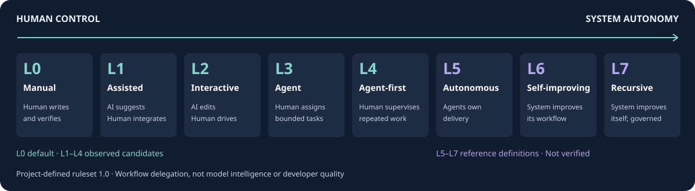

# Agent Level

[](https://github.com/fwhalbert/agent_level/actions/workflows/test.yml)

[English](README.md) | [简体中文](README.zh-CN.md)

Agent Level 基于 **Claude Code 和 Codex** 的本地活动与任务证据，
分析人和 Agent 如何分担工程工作。

## 能做什么

- **了解工作方式：** 查看 L0–L7 候选等级、判断依据和缺少的条件。
- **查看任务结果：** 汇总预先登记的验收检查结果。
- **对比改进效果：** 在同一冻结任务集上对比工作流变更。
- **查看使用情况：** 展示每日 Token 用量、模型与角色占比和缓存使用。
- **检查验证覆盖：** 区分最后编辑后的验证、历史工作流信号和日志采集缺口。

支持中英文离线 HTML 报告，也可导出文本、Markdown 和 JSON。
报告包含汇总信息和不透明诊断引用，不包含原始对话或源码。

**本地分析 · 不上传源码 · 基于证据 · 中英文报告**



## 快速开始

需要 Git 和 Python 3.10+，运行时无第三方依赖。
在 Linux / macOS 的 bash 或 zsh 中，从源码目录运行一条 setup 命令，
将项目路径改为要评估的项目的绝对路径：

```bash
git clone https://github.com/fwhalbert/agent_level.git
cd agent_level
./agent-level setup --project-dir /absolute/path/to/your-project
```

Setup 自动创建或复用虚拟环境、安装命令，在 `AGENTS.md`、`CLAUDE.md` 中引用任务记录指令，
并配置会话提示 hook。完成后会打印可在任意目录直接运行的报告命令，无需激活虚拟环境；
项目指令中也会写入 recorder 的完整命令路径。已安装工具时，可在项目中运行 `agent-level setup`。
运行 setup 打印的报告命令，再在浏览器打开输出的 `file://` 链接，默认报告路径为
`out/agent_level/YYYY-MM-DD/agent-level.html`。

在目标项目开启新的 Claude Code 或 Codex 会话，照常交给它工程任务。
Agent 按[记录流程](AGENTS.md)登记验收检查并记录结果。
hook 只显示 “Auto eval enabled.”；Codex 的新 hook 需要先在 `/hooks` 中信任。
任务完成后，运行 setup 打印的报告命令更新报告。

请保留本工具源码目录，移动目录或更换虚拟环境后重新运行 setup。
仅安装分析器及更多选项见[配置指南](docs/SETUP.md)，或运行 `agent-level --help`。

## L0–L7 框架

| 等级 | 工程工作方式 | 人的角色 |
|---|---|---|
| L0 — 手工工程 | 人实现并验证 | 开发者 |
| L1 — AI 辅助 | AI 建议，人整合 | 开发者 |
| L2 — 交互式编码 | AI 修改，人决定步骤 | 步骤决策者 |
| L3 — Agent 编码 | 人提出任务，Agent 修改并尝试验证 | 任务发起者 |
| L4 — Agent 优先 | 修改/验证流程跨会话、跨天持续出现 | 监督者 |
| L5 — 自主工程 | Agent 接任务、交付、修复 CI、跟踪结果 | 需求与验收负责人 |
| L6 — 自我改进 | 系统改进提示词、工具和流程，具备评估与回滚 | 改进与治理负责人 |
| L7 — 受治理的递归改进 | 在人的治理下研发后续系统 | 研究与治理负责人 |

`DEFAULT` 表示 L0 默认基线，包括没有匹配日志时。`OBSERVED` 表示日志支持 L1–L4 候选等级，
不代表任务成功。L5–L7 保留为 `NOT VERIFIED` 参考定义，任务验收结果单独评估。

项目自定义规则集 **1.0** 描述工作流自主程度，不衡量开发者水平或模型智力，也不是行业标准。
[完整定义与阈值](docs/AGENT_LEVEL_L0-L7.md)。

## 参考资料

- [配置与任务记录](docs/SETUP.md)
- [任务评估与 JSON 协议](docs/ANTHROPIC.md)
- [工作流指标、冻结标准与人工复核](docs/WORKFLOW_METRICS.md)
- [改进前后对照](docs/IMPROVEMENT_EVALUATION.md)
- [OpenAI 指南与实现范围](docs/OPENAI.md)
- [方法、一手来源与限制](docs/REFERENCES.md)
- [架构](docs/ARCHITECTURE.md)
- [贡献指南](CONTRIBUTING.md) · [安全报告](SECURITY.md) · [MIT 许可证](LICENSE)
